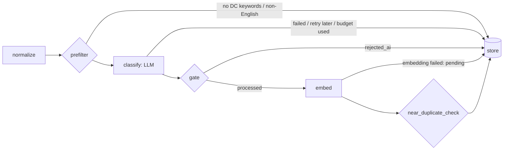

# AI Configuration

How NewsDC uses AI in the processing pipeline (Phase 3) and in the Ask NewsDC assistant (Phase 6): models, prompts, thresholds, limits, costs and how quality was measured.

## Pipeline

`backend/app/pipeline/graph.py`, one LangGraph run per item with `status = new`:

| Node | What it does | Cost |
|---|---|---|
| normalize | Strips HTML and scripts, collapses whitespace, caps text at 6,000 chars | free |
| prefilter | Word-bounded keyword match (category keywords + general DC vocabulary). Score 0 → `rejected_prefilter`, unless the source is DC-specific (`dc_specific: true`: DCD, DCK). Non-English text is rejected unless the title has a DC keyword | free |
| classify | One LLM call with a cached system prompt and a strict JSON schema; Pydantic validation; one repair call if invalid | ~$0.0002 per item (see below) |
| gate | `processed` if `is_relevant` and not spam and relevance ≥ `RELEVANCE_THRESHOLD` and quality ≥ `QUALITY_THRESHOLD`; else `rejected_ai` (annotation kept) | free |
| embed | fastembed `BAAI/bge-small-en-v1.5` (384-dim, local CPU) on `title + summary` | free |
| near_duplicate_check | Cosine similarity > `NEAR_DUPLICATE_THRESHOLD` (0.92) with a processed item published within ±14 days → `duplicate`, with `duplicate_of`, similarity and reason | free |
| store | Annotation + status in one transaction, only while the item is still `new` | |

Every outcome records why in `items.status_reason`; AI rejections also keep the full annotation (`reject_reason`, scores, categories).

## Models

| Use | Env var | Value used locally | How it was verified |
|---|---|---|---|
| Classifier | `CLASSIFIER_MODEL` | `claude-haiku-5-5` | Models API (`models.retrieve`) returned "Claude Haiku 5.5" for this key on 2026-11-09; pricing page checked the same day |
| Assistant | `ASSISTANT_MODEL` | `claude-opus-5-5` | Models API (`models.retrieve`) returned "Claude Opus 5.5" (1M context, 128k output, effort supported) for this key on 2026-11-09 |
| Embeddings | fixed in code (`app/ai/embeddings.py`) | `BAAI/bge-small-en-v1.5`, 384 dims | Must match `items.embedding vector(384)`; changing it needs a re-embedding migration |

The code and `.env.example` have **no default model ID** (D-007). Why Haiku: classification is a narrow, high-volume task. The evaluation (below) shows it is good enough at about $0.0002 per item. A stronger model can be swapped in through `CLASSIFIER_MODEL`, followed by re-running the evaluation.

Request settings (`app/ai/llm.py`): structured outputs (`output_config.format` with a JSON schema; category slugs and content types are enums), `output_config.effort = CLASSIFIER_EFFORT` (`low`), `max_tokens` 4,000, system prompt sent as a cached block (`cache_control: ephemeral`), connect timeout 5 s, read timeout `LLM_TIMEOUT_SECONDS` (60 s), SDK retries 3 (exponential backoff, honours Retry-After). Forced `tool_choice` is not used because current Opus/Sonnet/Fable models reject it (D-024).

## Prompt

- File: `backend/app/prompts/classify.md`. Version `classify-v2` (`PROMPT_VERSION` in `app/ai/classify.py`). A unit test pins the file's sha256 to the version, so editing the prompt without bumping the version fails CI.
- The enabled categories (slug, name, description) are rendered into `{{CATEGORIES}}` in sort order, so the system prompt is byte-identical for every item and is served from the prompt cache (about 3,500 tokens; Haiku 5.5's minimum cacheable prefix is 512).
- Each annotation stores `model`, `prompt_version`, `prompt_hash` (sha256 of the rendered system prompt), tokens in/out, latency, attempts and estimated cost.
- The prompt defines: relevance scale (90+ core DC news … <30 not about DCs; `is_relevant` only at ≥ 50), quality scale (title-only items rated by headline specificity, never above 60), spam, the 4 content types with examples, and "insights and entities only if stated in the item; no outside knowledge".
- Prompt-injection handling: the item is sent as quoted data inside `<item>` tags with `<` and `>` escaped; the prompt says text inside the item is never an instruction. Items trying to instruct the model count as spam.
- Changelog: `classify-v1` → `classify-v2` changed the title-only quality rule after evaluation run 1 (D-028). Items annotated with an older version can be re-queued with `python -m app.pipeline --reprocess-outdated`.

## Thresholds and limits

| Setting | Default | Meaning |
|---|---|---|
| `RELEVANCE_THRESHOLD` | 55 | Minimum relevance to publish |
| `QUALITY_THRESHOLD` | 40 | Minimum quality to publish |
| `NEAR_DUPLICATE_THRESHOLD` | 0.92 | Cosine similarity for near-duplicates (±14 days). A reviewable heuristic; similarity and reason are stored |
| `MAX_LLM_ITEMS_PER_RUN` | 300 | LLM calls per pipeline run; the rest stay `new` for the next run (`stop_reason` recorded) |
| `DAILY_LLM_BUDGET_USD` | 5 | No new LLM calls once today's (UTC) estimated spend reaches this. Needs the two price settings |
| `CLASSIFIER_INPUT_USD_PER_MTOK` / `CLASSIFIER_OUTPUT_USD_PER_MTOK` | 0 (unknown) | Haiku 5.5: 0.10 / 0.50. Cache writes are costed at 1.25× input and cache reads at 0.1× |
| `LLM_CONCURRENCY` | 5 | Items classified in parallel |
| Per-item retries | 3 | Transient LLM failures before an item is marked `failed` (it stays `new` until then) |
| Provider outage | 5 | Consecutive transient failures that abort the run (job retried with backoff) |

## Costs (measured)

Live runs on 2026-11-09 with `claude-haiku-5-5` (`classify-v2`, effort `low`), from `ai_annotations` and `pipeline_runs`:

| | |
|---|---|
| Items classified (annotations) | 3,843 |
| Estimated cost | **$1.13 total, about $0.00029 per classified item** |
| Tokens | 15.70M input (mostly prompt-cache reads of the ~3,500-token system prompt), 1.62M output |
| Mean latency | 2.7 s per call; about 1.9 items/s with 5 in parallel |
| Repair retries | 0 (structured outputs kept every answer schema-valid) |
| Run 29 (full backlog, 3,895 items) | 34 min 42 s, $1.064 |
| Run 30 (289 re-queued items) | 2 min 24 s, $0.064 |

At the default `MAX_LLM_ITEMS_PER_RUN=300`, an hourly run costs at most about $0.09; `DAILY_LLM_BUDGET_USD=5` is a safety net, not the expected spend. The evaluation script costs about $0.01 per run. The estimate uses the configured prices and the token counts the API returns; the provider's invoice is the authority.

## Evaluation

40 hand-labelled real items (agent-labelled; **human review pending**). Current prompt `classify-v2`: relevance precision 20/22 (90.9%), recall 20/20 (100%), primary-category accuracy 16/20 strict, 18/20 lenient. Run 1 (`classify-v1`) had recall 15/20 because title-only HN items failed the quality gate. That finding led to v2, measured on the same items, so v2's numbers are optimistic. Full results, confusion matrices and limitations are in [AI_EVALUATION.md](AI_EVALUATION.md).

Re-run: `cd backend && uv run python scripts/eval_classifier.py` (about $0.01).

## Failure behaviour

| Failure | What happens |
|---|---|
| Rate limit / overload / 5xx / timeout | SDK retries; if it still fails, the item stays `new` (`ai_attempts` + 1) and is retried next run; `failed` after 3 |
| 5 transient failures in a row | Run aborts as "provider unavailable"; the job goes to `retry_wait` with backoff |
| Bad key / permission / unknown model | Run aborts, no item is touched; the job is dead-lettered with the reason |
| Invalid output twice, or a refusal | That item is marked `failed` with the reason |
| Embedding failure | Item stays `processed` (still in the feed); embedding pending, filled by the next run |
| Budget reached | Remaining items stay `new`; `pipeline_runs.stop_reason` says which limit |

Logs never include API keys, the system prompt or article bodies, only item IDs, statuses, reasons and exception types.

## Ask NewsDC (Phase 6)

| Setting | Value | Why |
|---|---|---|
| `ASSISTANT_MODEL` | `claude-opus-5-5` (local `.env` only; code default is empty) | The answer is the one place where quality is user-visible and volume is low. The current Opus generation, verified through the Models API |
| `ASSISTANT_EFFORT` | `low` | Short, grounded answers over 8 sources don't need deep reasoning. Opus 5.5 can't turn thinking off, so effort is the control. `low` kept answers at 6–10 s |
| `ASSISTANT_MAX_TOKENS` | 4,000 | Hard cap per answer (thinking + text). Live answers used 570–960 output tokens |
| `RATE_LIMIT_ASK` | 10/minute per IP | On top of the 60/minute default, because every call is paid |
| `ASSISTANT_INPUT_USD_PER_MTOK` / `ASSISTANT_OUTPUT_USD_PER_MTOK` | 4.00 / 20.00 locally | Cost logging only. From the model table in Anthropic's API reference material as of 2026-10-06; **not re-checked on the live pricing page** |

- **Prompt:** `backend/app/prompts/assistant.md`, version `assistant-v1` (`PROMPT_VERSION` in `app/ai/assistant.py`, pinned to the file's sha256 by a test). Each answer's log line carries the model, prompt version, token counts, latency, cost estimate, number of sources and citations, and removed citations. The question text is not logged.
- **Grounding rules (in the prompt):** answer only from the numbered sources; say plainly when they don't cover the question; present conflicts with both citations; mention when the newest source is old; cite every factual sentence as `[n]`; no URLs or reference list (the UI shows the backend's links).
- **Prompt injection:** sources are wrapped in `<source>` tags with angle brackets escaped, and the system prompt says source text is untrusted data that is never followed. History can clarify the question, but it can't change the rules.
- **Citation validation:** `CitationFilter` removes any `[n]` that isn't a supplied source before the text reaches the client, and `done` reports `cited` and `removed_citations`.
- **No evidence:** when retrieval finds nothing, a fixed answer is sent and no LLM call is made.
- **Failure behaviour:** provider errors (after the SDK's 3 retries) become an `error` event (`llm_unavailable` or `llm_error`). A refusal or an empty answer becomes `no_answer`. `done` is never sent after an error. Server-side refusal fallbacks (`fallbacks`, beta) are not enabled. A refusal on data center news is unlikely, and it surfaces as `no_answer`.
- **Prompt caching:** the system prompt is sent with `cache_control`, but at about 600 tokens it is below Opus's minimum cacheable prefix, so it doesn't cache today. The sources change per question and come after it.

### Costs (measured)

Seven live questions on 2026-11-09 (the 5 examples, a follow-up and an off-topic one; uvicorn log; $0.193 in total): 3,375–4,151 input tokens, 571–961 output tokens, 5.7–9.5 s, **$0.024–$0.036 per answer** at the prices above. 1,000 questions a day would be about $30.

Ask NewsDC has no daily spend cap yet. The per-IP rate limit and the max-tokens cap bound it. A global daily cap belongs with the Admin spend view in Phase 8 (D-033).
