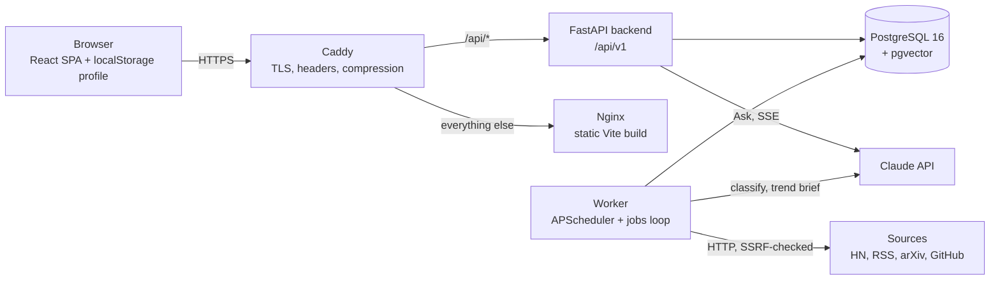
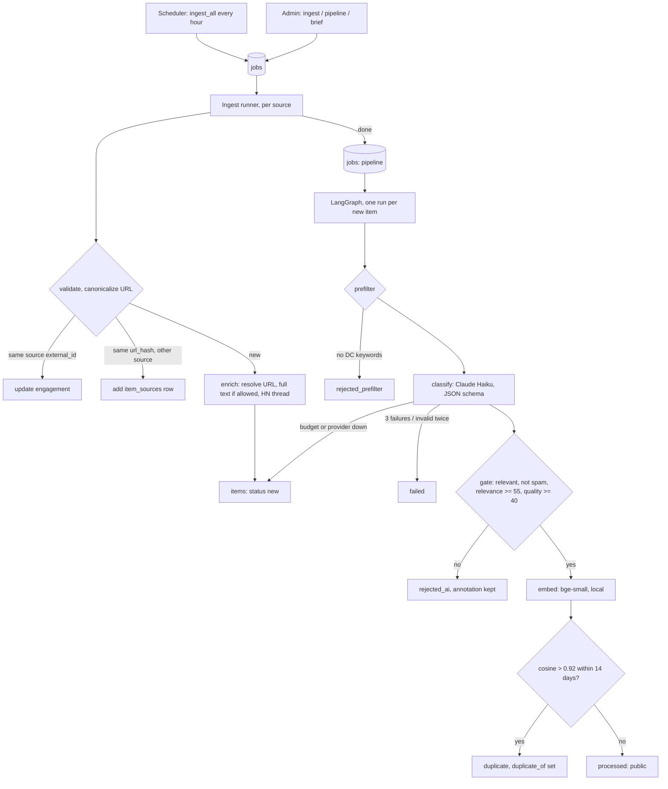
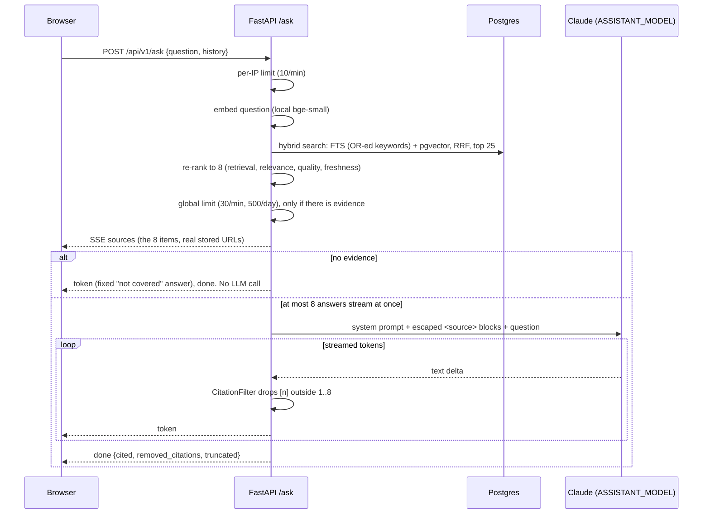

# NewsDC Architecture

How NewsDC is put together: the processes, the ingestion and AI workflow, Ask NewsDC, the ranking formulas and the main trade-offs. The API contract is in [API.md](API.md), the AI settings in [AI_CONFIG.md](AI_CONFIG.md), production in [DEPLOYMENT.md](DEPLOYMENT.md) and every deviation from the plan in [DECISIONS.md](DECISIONS.md).

## System

An editable version of the system and pipeline diagrams is in [diagrams/newsdc.excalidraw](diagrams/newsdc.excalidraw) (open it at excalidraw.com or with the VS Code Excalidraw extension). Rendered PNGs of the three Mermaid diagrams below are in `img/arch-system.png`, `img/arch-pipeline.png` and `img/arch-rag.png` (used by the presentation).



- **Four app containers** in `docker-compose.prod.yml` (`db`, `backend`, `worker`, `frontend`) plus `caddy`. Only Caddy publishes ports (80/443). The database has no public port.
- **Backend and worker are the same image.** The API never ingests or classifies. Admin actions and the schedule only *enqueue* rows in the `jobs` table, and the worker claims them (`SKIP LOCKED`, heartbeat leases, retries with backoff, dead letters, one active job per kind; D-026).
- **The frontend talks to the backend only over `/api/v1`** (`frontend/src/lib/api.ts`). In production both are on one origin behind Caddy, so there is no CORS.
- **Postgres holds everything:** items, provenance, annotations, embeddings (pgvector HNSW), full-text indexes, jobs, runs, trend briefs and Admin state (rate-limit counters are in memory). Nightly encrypted `pg_dump` (`scripts/backup_db.sh`).

## Ingestion and processing workflow



Each source runs on its own: one failing source records its error on its `sources` row and in `pipeline_runs`, and the others go on. Pages are committed together with the source's checkpoint, so an interrupted backfill resumes where it stopped. `store` writes the annotation and the status in one transaction, and only while the item is still `new`. Every status carries a reason in `items.status_reason`.

## Ask NewsDC (RAG) sequence



The browser renders `[n]` as links to the source cards only, and shows any other link the model wrote as plain text. A provider error, refusal or empty answer ends the stream with an `error` event and never `done`.

## Key design decisions and trade-offs

| Decision | Why | Trade-off |
|---|---|---|
| **Postgres for everything** (data, vectors, full-text search, job queue) | One service to run, back up and secure on a 4 GB VPS. pgvector HNSW and `tsvector` are fast enough for tens of thousands of items, and both search types can be fused in one SQL query. `SKIP LOCKED` makes a durable queue without Redis | Doesn't scale like a dedicated search engine or broker. At millions of items, search would move to a separate index |
| **Haiku for classification, Opus for Ask** (plan said Sonnet) | Classification is narrow and high volume: Haiku costs $0.29 per 1,000 articles and passed the evaluation. Ask is low volume, and its quality is what users see. Models come from env vars only (D-007) | Opus answers cost about $0.03 each, so `/ask` has per-IP and global limits and an 8-stream cap |
| **Local embeddings** (fastembed bge-small, 384 dims, CPU) | Free, private and deterministic. No second API key or provider outage. Embedding a question takes milliseconds | Lower quality than large hosted embedding models. Changing the model means re-embedding everything (migration) |
| **localStorage profile, no accounts** | No personal data on the server, nothing to secure or delete, and works from the first visit. The profile is sent with each For You request and validated with strict limits | The profile doesn't follow the user across devices and is lost when site data is cleared |
| **Keyword prefilter before the LLM** | Free. It removes obvious off-topic items from broad sources (HN) before they cost money, and it is word-bounded and explainable | It can drop a relevant item that uses none of the keywords. DC-specific sources skip it |
| **Exact dedupe by canonical URL hash plus many-to-many provenance** | One story found by HN and an RSS feed is one item with two sources, and "Also covered by" and the coverage boost come for free | Canonicalization is conservative (it doesn't rewrite http to https, D-010), so some duplicates fall to the near-duplicate step |
| **Near-duplicates by embedding similarity** (> 0.92, ±14 days) | Catches the same announcement rewritten by different outlets, with the similarity and reason stored | A heuristic: very similar but distinct stories can be merged. The threshold is a setting |
| **Durable jobs table instead of in-process scheduling** | Jobs survive restarts and deploys, retry with backoff and end in a dead letter that Admin can retry | More code than a cron line, but the first-load incident in Phase 10 (a container recreate killed a run) showed why it matters |
| **Vite SPA, not Next.js** (§11.1) | The backend owns the API. A static build behind Nginx is simple to cache and has no Node server in production | No server-side rendering, so link previews and SEO are basic |

## Recommendation engine

Code: `backend/app/recommend/` (`scoring.py` holds the formulas, `foryou.py` the For You ranking). Each formula is written once as a Python function. The same function runs on plain numbers (unit tests, For You) and on SQLAlchemy columns (the `ORDER BY` of the paginated feeds), so the SQL can't drift away from the documented formula. `test_relevant_feed_matches_the_python_formula` checks this against Postgres.

Ages are measured from `published_at`, or from `fetched_at` when the source gave no date, and are never negative. A missing score or engagement count counts as 0. Every ordering ends with `published_at DESC, id DESC`, so pagination is deterministic.

### Trending (`/feeds/trending`, `sort=trending`)

```
score = (1 + points + 2·comments + quality/10 + 5·coverage) / (age_hours + 2)^1.5
```

This is Hacker News gravity. `points` and `comments` are Hacker News points and comments (GitHub stars count as points). Items from RSS and arXiv have no engagement data, so they rank on quality and coverage alone. `coverage` counts the other outlets that carried the story: near-duplicates whose `duplicate_of` points at the item, plus every extra source in `item_sources` that found the same URL (D-032). Because of gravity, an item loses about 65% of its score between 2 h and 6 h old, so a fresh RSS item soon outranks a three-day-old HN item with 100 points. That is the intended behaviour for a "what's happening now" feed.

### Most relevant (`/feeds/relevant`, `sort=relevant`)

```
score = (0.6·relevance + 0.4·quality) / (1 + age_days/30)
```

The decay is mild. A month-old item keeps half its score, so a strong item from a few days ago still beats a weak one from today. `sort=relevance` (plain `relevance_score`) is unchanged from Phase 4.

### By topic (`/topics/{slug}`)

A category filter, plus any sort: `latest`, `relevance`, `quality`, `trending` or `relevant`.

### Related (`/items/{id}/related`)

```
score = cosine_similarity(embeddings) + 0.1 · shared_categories
```

It takes the 50 nearest processed items by HNSW and returns the top 6. Near-duplicates have the status `duplicate`, so they are never candidates, and the same story isn't shown twice.

### For You (`POST /feeds/foryou`)

The browser keeps an anonymous profile in `localStorage` and sends it with each request. There are no accounts and nothing is stored on the server.

```json
{"categoryWeights": {"cooling": 7.5}, "tagWeights": {"immersion": 3},
 "readIds": [12, 40], "bookmarkIds": [7], "dismissedIds": [99], "explicitTopics": ["cooling"]}
```

**Client side (Phase 9B):** opening an article adds +1, reading for more than 30 s +2, a bookmark +3, "not interested" −3. The +1, +2 and +3 apply to the item's categories and tags. Weights decay ×0.95 per day. `readIds` keeps the last 200 items. A "Reset my preferences" button clears the profile.

**Server side:**
1. **Validation.** The limits are 64 category weights, 200 tag weights, 200 read IDs, 500 bookmark IDs, 500 dismissed IDs and 64 explicit topics. Weights must be finite and within ±1000. Category slugs must exist. Unknown fields are rejected. The body is at most 64 KiB.
2. **Candidates.** These are the newest 1,000 public items, minus read, bookmarked and dismissed items.
3. **Taste.** Category weights, with +5 for each topic picked at onboarding, are divided by the largest absolute weight. The result is in [−1, 1]. Tag weights are normalised the same way and lower-cased. The taste embedding is the average embedding of the 50 most recent reads and the 50 most recent bookmarks.
4. **Score.**
   ```
   0.35·category_affinity + 0.25·embedding_similarity + 0.15·tag_affinity + 0.15·quality/100 + 0.10·freshness
   ```
   An affinity is the strongest weight among the item's categories (or tags). Similarity is the cosine to the taste embedding, clipped to ≥ 0. Freshness is `0.5^(age_days/7)`.
5. **Discovery.** A category is *engaged* if it has a weight (liked or disliked), was picked at onboarding, or is the primary category of a read or bookmarked item. Items with quality ≥ 60 and no engaged category form the discovery pool. They are ordered by quality and rotate through categories. Every 5th slot (20%) is filled from this pool, and the item is labelled `Discover: <Category>`. A disliked category never appears as discovery.
6. **Reason.** Each item gets a reason from the largest positive part of its score. Examples: "Because you read 4 Cooling articles", "Because you picked Cooling", "Because you're interested in “immersion”", "Similar to articles you read or saved". When no part is positive, the reason is "High quality and recent".
7. **Cold start.** If the profile has no positive signal (dismissals alone don't count), the feed alternates Trending and Most relevant without repeats, and the response has `cold_start: true`. The UI then shows the topic picker (Phase 9B).

The ranking runs in Python over at most 1,000 candidates. Measured on 2,609 live items it took 52 ms. If the pool ever needs to grow much larger, the scoring should move into SQL.

## Ask NewsDC retrieval (Phase 6)

Code: `backend/app/api/ask.py` (retrieval, SSE endpoint), `backend/app/ai/assistant.py` (prompt, evidence block, citation filter), `backend/app/prompts/assistant.md`.

1. **Query:** the question, plus the previous user question from `history` so follow-ups keep their topic.
2. **Candidates:** the Phase 4 hybrid search (`search.hybrid`) with the keywords OR-ed (`plainto_tsquery` with `&` replaced by `|`) instead of `websearch_to_tsquery`'s AND, because a whole question rarely matches every word. `ts_rank_cd` still ranks items that match more words first. Top 25 by RRF.
3. **Re-rank to 8** with `scoring.ask_rank`:

   | | retrieval | relevance | quality | freshness |
   |---|---|---|---|---|
   | normal question | 0.50 | 0.20 | 0.15 | 0.15 |
   | recent ("latest", "this month", "emerging", …) | 0.35 | 0.15 | 0.15 | 0.35 |

   `retrieval = 1 − position/25` in the RRF list (1.0 for the best hit). Raw RRF scores were tried first, but they sit too close together (rank 2 has 98% of rank 1's score), so freshness decided everything. `freshness` halves every 7 days (the For You function). Relevance and quality are the 0–100 AI scores divided by 100. Ties are broken by `id DESC`.
4. **Evidence:** each source is `[n] title, publisher, date, url, summary (≤1,200 chars), key insights (≤5 × 300 chars)` inside `<source n="…">` tags with `<` and `>` escaped, so about 3,500–4,200 input tokens per question.
5. **Answer:** streamed from `ASSISTANT_MODEL`. Text passes through `CitationFilter`, which drops citation numbers outside 1..8 (holding back an unfinished `[` so a marker split across chunks is checked whole).

## Rising topics and trend brief (Phase 7)

**Rising topics** (`app/ai/trends.py:rising`) over processed items, separately for tags, companies and technologies:

- Windows: recent = the last 7 days, baseline = the 28 days before (by publication date, fetch time when missing).
- A term is matched case-insensitively and counted once per item. It is shown in its most common spelling.
- `share_recent = recent / items_recent`, `share_baseline = max(baseline, 1) / items_baseline`
- `change_pct = round((share_recent / share_baseline − 1) × 100)`
- Listed when `recent ≥ 3` and `change_pct > 0`, ordered by `change_pct`, then `recent`; top 10.

Shares, not raw counts, because collection volume varies (RSS feeds only return recent items, so the last week always has more items). A term absent from the baseline counts as 1 baseline item, so it gets a finite change and ranks with the rest (`new: true`). For companies, the item's own publisher is dropped (the classifier often lists the outlet itself).

**Trend brief** (`generate_brief`): the 30 processed items of the last 7 days with the highest *relevant* score (relevance and quality, mild age decay) become numbered `<source>` blocks (the same escaped format as Ask NewsDC), followed by the rising topics as a hint. `ASSISTANT_MODEL` writes 250–400 words of themes with `[n]` citations. Unknown numbers are removed; a brief without any valid citation, a refusal or a cut-off answer is not stored. `trend_briefs.sources` keeps the 30 ids in order, so `[n]` is `sources[n-1]`. Fewer than 5 items in the week: no brief and no LLM call.
