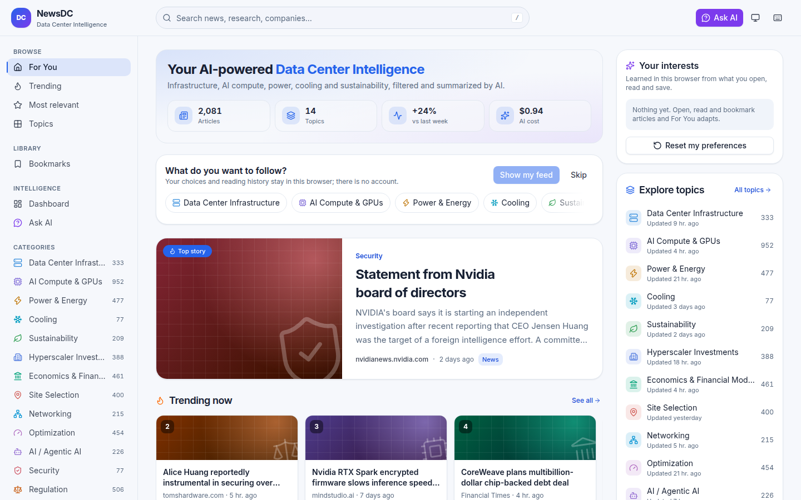
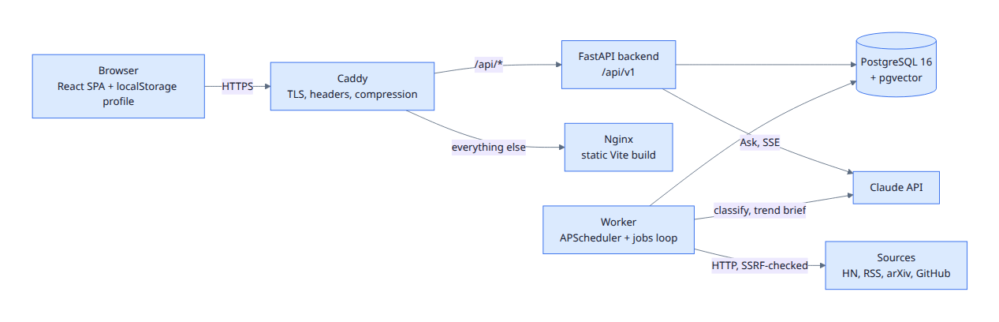
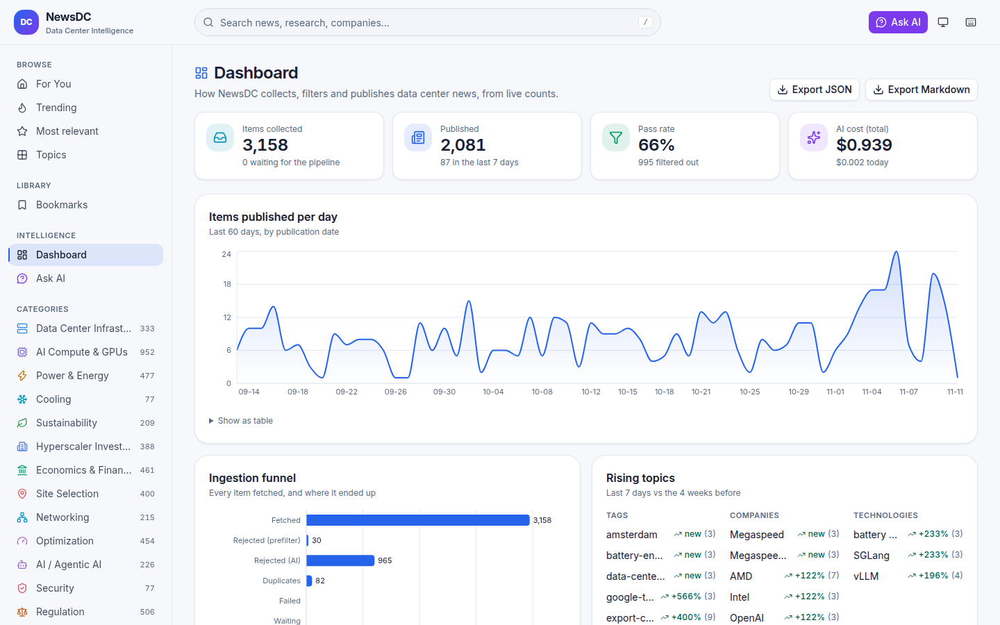

<!--
Export (from the repo root; needs Chrome):
  npx -y @marp-team/marp-cli@4 docs/PRESENTATION.md --html --theme-set docs/theme/newsdc.css --pdf -o docs/NewsDC_Presentation.pdf
  npx -y @marp-team/marp-cli@4 docs/PRESENTATION.md --html --theme-set docs/theme/newsdc.css -o docs/NewsDC_Presentation.html
Numbers are from the live site on 2026-11-11 and from docs/AI_EVALUATION.md. Refresh them from the Dashboard before presenting.
Diagrams: docs/img/arch-*.png are rendered from the Mermaid in docs/ARCHITECTURE.md.
-->

<!-- _class: cover -->
<!-- _paginate: false -->

Recruitment assignment · Working MVP

# NewsDC

AI-powered discovery and recommendation for Data Center news, research and engineering.

**Live:** https://news-dc.atinus.co · **Code:** github.com/shubhambgp/news-dc

<!--
Speaker: one sentence: "NewsDC is like Hacker News for the data center industry. It collects content, has AI filter and explain it, and gives every reader a personal feed without an account."
-->

---

## The problem

Finding the 5% that matters doesn't scale by reading everything.

### Scattered
Data center news lives on HN, trade press, arXiv, GitHub and financial outlets, with no single place to read it.

### Noisy
Most of HN is off-topic. Trade press repeats the same announcement many times.

### Different readers, different slices
Engineers want cooling and GPUs. Investors want power deals and capex. Policy people want regulation.

### No time
Nobody reads 3,000 items a year to find the 150 that change a decision.

---

## The solution

1 · Collect<i>→</i>2 · Filter and explain with AI<i>→</i>3 · Recommend<i>→</i>4 · Ask<i>→</i>5 · Watch trends

- **Collect** from 9 public sources every hour, deduplicated by canonical URL, every source kept as provenance
- **Filter and explain:** relevance, spam, 14 categories, content type, summary, insights, quality score, with a reason on every rejection
- **Recommend:** Trending, Most relevant, By topic, Related, and **For You** from localStorage, no account
- **Ask:** questions answered only from stored articles, with real citations
- **Watch trends:** rising topics and a weekly AI brief

<b>3,158</b>items collected

<b>2,081</b>published after AI filtering

<b>14</b>configurable categories

<b>$0.94</b>total AI spend so far

---

<!-- _class: dark -->

## The product

- Personal **For You** feed with a "why" on every item
- Discover picks from topics you haven't read
- Trending, Most relevant, Topics, Search, Bookmarks, Dashboard
- Light and dark themes, keyboard shortcuts, phone-ready

Home page on the live site, 2026-11-11

---

## Live demo flow

Home / For You<i>→</i>Article<i>→</i>Bookmark<i>→</i>Topics<i>→</i>Search<i>→</i>Ask AI<i>→</i>Dashboard<i>→</i>Admin<i>→</i>Export<i>→</i>Theme + <code>?</code>

1. **First visit:** pick Cooling and Power. The feed adapts, every item says why it is there, every 5th item is a Discover pick
2. **Article:** summary, technical and business insights, entities, quality score, the HN discussion, "Also covered by"
3. **Search** "liquid cooling": full text plus vectors, fused with RRF
4. **Ask AI** two of the assignment's example questions, click a `[n]` to jump to its source
5. **Dashboard:** the ingestion funnel and AI cost
6. **Admin:** rejected items with reasons, queue an ingestion, export Markdown

### Backup
If the network fails: `demo/newsdc-demo.webm`, a 90-second captioned recording of this exact flow on the live site.

<!--
5-MINUTE DEMO SCRIPT
0:00 Home. "First visit: I pick Cooling and Power. The feed adapts. Every item says why it is here, and every 5th item is Discover from a topic I haven't read."
0:40 Open the top article. "Summary, technical and business insights, entities, quality score, the original link, the HN discussion, and 'Also covered by' when several outlets carried it." Press b to bookmark.
1:20 Topics → Cooling. "14 categories, configurable in YAML and in Admin." Then press / and search "liquid cooling". "Hybrid search: full text plus vectors, fused with RRF."
2:00 Ask AI: "What are the latest developments in liquid cooling?" Point at a [n] and click it: it jumps to the source card. "Each number maps to a stored article. Numbers the model invents are removed before they reach the browser."
2:45 Second question: "Which companies are investing in nuclear power for data centers?"
3:15 Dashboard. "3,158 collected, 2,081 published. 30 removed by the free keyword filter, 965 by the AI, 82 near-duplicates. Total AI cost so far is under one dollar."
3:50 Admin: log in, open Rejected items. "Every rejection keeps its reason." Queue an ingestion and show it under jobs.
4:30 Export Markdown, toggle the theme, press ? for the shortcuts.
4:50 "All of it runs on one 4 GB VPS with Docker Compose."
-->

---

## Architecture

- **Backend and worker:** one image, two containers. The API never ingests, it only enqueues jobs
- **Postgres does everything:** data, vectors (HNSW), full text, the job queue (`SKIP LOCKED`)

- The frontend talks to the backend only through `/api/v1`
- Only Caddy publishes ports. The database has no public port

<!--
Speaker: the diagrams with more detail are in docs/ARCHITECTURE.md (Mermaid). Why one database: one thing to back up and secure on a small VPS.
-->

---

## Ingestion and the AI pipeline

One LangGraph run per new item. Every status carries a reason.

normalize<i>→</i>prefilter (free)<i>→</i>classify · Claude Haiku · JSON schema<i>→</i>gate<i>→</i>embed (local)<i>→</i>near-duplicate<i>→</i>store

### Ingestion
- Adapters: HN (Algolia), RSS/Atom, arXiv, GitHub. Terms and robots.txt checked per source
- Canonical URL → hash → **one item, many sources** (`item_sources`)
- Every request: SSRF check on each redirect hop, pinned connections, size caps, throttling, retries

### Pipeline
- Prompt from a versioned file, output validated against a strict schema
- Gate: relevant, not spam, relevance ≥ 55, quality ≥ 40
- Spend caps per run and per day. Failed items retry, then are marked `failed`
- Scheduler and Admin only enqueue. Durable jobs with leases, retries and dead letters

---

## AI filtering results

| Funnel (live) | Items |
|---|---|
| Collected | 3,158 |
| Rejected by keyword prefilter (free) | 30 |
| Rejected by AI (with reason) | 965 |
| Near-duplicates | 82 |
| **Published** | **2,081** (66%) |

<b>20/22</b>precision

<b>20/20</b>recall

<b>16/20</b>primary category (18/20 lenient)

<b>$0.29</b>per 1,000 articles, Claude Haiku 5.5

Evaluation on 40 labelled items with prompt `classify-v2`. Every rejected item keeps its annotation and reason, visible in Admin.

<!--
Be honest: the 40 labels were made by the agent and I still have to review them. v2 was tuned after run 1 on the same items, so its numbers are optimistic.
-->

---

## Recommendations

### Trending
HN-style gravity
`(1 + points + 2·comments + quality/10 + 5·coverage) / (age_h + 2)^1.5`

### Most relevant
`(0.6·relevance + 0.4·quality) / (1 + age_days/30)`

### Related
Embedding cosine + 0.1 × shared categories

### For You localStorage, server stores nothing
Profile from reading activity: open +1, read 30 s +2, bookmark +3, dismiss −3, ×0.95 daily decay.

`0.35 category + 0.25 embedding + 0.15 tag + 0.15 quality + 0.10 freshness`

- 20% **discovery** slots from topics you haven't read
- A **"why"** on every item
- Onboarding chip picker on the first visit, no account

---

## Ask NewsDC RAG with citations

1. Hybrid retrieval (full text + pgvector, RRF) → top 25 → re-rank to 8
2. Sources go in as escaped `<source n>` blocks. Source text is data, never instructions
3. Streamed over SSE: `sources` → `token`* → `done`
4. `CitationFilter` drops any `[n]` that isn't a supplied source, even when split across chunks
5. No evidence means a fixed answer and **no LLM call**
6. Per-IP, global (30/min, 500/day) and concurrency limits cap the spend

> Live: 5/5 of the assignment's example questions answered with valid citations, $0.02–$0.04 per answer.

### The assignment's example questions
- What are the latest developments in AI data center infrastructure?
- Which hyperscalers are investing in new data centers?
- What is emerging in liquid cooling and power availability?
- Which articles discuss GPU utilization optimization?
- What technologies could improve PUE and WUE?

All five answered live with citations that map to stored items (VERIFICATION_LOG, Phase 6). Sequence diagram: docs/ARCHITECTURE.md.

---

<!-- _class: dark -->

## Trends and dashboard

- **Rising topics:** tags, companies and technologies, last 7 days vs the 28 before
- **Weekly AI brief** with checked citations, Mondays 06:00 UTC
- Funnel, per category, source and day, average quality, last runs
- **AI cost** per run and in total
- Export JSON or Markdown from here

---

## Tech choices and trade-offs

| Choice | Why | Cost |
|---|---|---|
| Postgres for everything | One service; hybrid search in one query | Not for millions of items |
| Haiku classifies, Opus answers | Cheap at volume; quality where users see it | Ask needs strict limits |
| Local embeddings (bge-small) | Free, private, no second provider | Lower quality than hosted models |
| localStorage profile | No personal data, works on the first visit | No sync across devices |
| Prefilter before the LLM | Removes obvious noise for free | Can miss unusual wording |
| Vite SPA, not Next.js | Static build, no Node server | No SSR |

Stack: Python 3.12 · FastAPI · SQLAlchemy 2 · LangGraph · Anthropic SDK · fastembed · PostgreSQL 16 + pgvector · React 19 · Vite · Tailwind v4 · TanStack Query · Docker Compose · Caddy · GitHub Actions

---

## Security

### Application
- **Admin:** token login → HMAC-signed `HttpOnly` cookie, CSRF token + Origin check, login rate limit, disabled without strong secrets
- **SSRF:** public-address check on every hop, pinned connections (no DNS rebinding), no env proxies
- **XSS:** Markdown without raw HTML, model-written links shown as plain text, CSP from Caddy
- **Limits:** per-IP (IPv6 by /64), a global Ask budget, body size caps, strict schemas

### Deployment
- No public DB port, `cap_drop: ALL`, non-root images
- Encrypted backups, dependency audits in CI
- Secrets only in the server's `.env`, never in Git

### Audit
An external-style audit found **24 issues** (0 critical, 1 high: Ask spend). All triaged, fixed or accepted (D-040).

---

<!-- _class: dark -->

## How AI coding agents were used

- **Claude Code built it phase by phase from `plan.md`:** code, migrations, tests (388 backend, 12 Vitest, Playwright E2E) and docs
- **Agent-run operations:** backfills, the classifier evaluation, live checks, the VPS setup with my credentials
- **AI in the product:** classification, summaries and insights, the RAG assistant, the weekly trend brief
- **AI review:** a security audit (24 findings), then a code-review pass of the fixes: 6 low findings, all fixed with regression tests

- **Guard rails:** a verification log with only real command output, "pending human verification" until I confirm, decisions recorded as D-001…D-041
- **I did:** the review of every phase, the domain and DNS, the API keys, and the product decisions

<b>11</b>phases, one PR-sized review each

<b>41</b>recorded decisions

---

## Challenges and how they were solved

| Challenge | Fix |
|---|---|
| Title-only HN items failed the quality gate (recall 15/20) | Prompt v2 rates headline specificity (recall 20/20) |
| RRF scores too close together (rank 2 = 98% of rank 1) | Re-rank on rank position, not raw score |
| A container recreate killed the first production pipeline run | Everything goes through durable jobs with leases |
| Concurrent ingest deadlocked in CI (8 parallel runs: 11/25 failed) | A per-source transaction advisory lock, then 0/25 |
| Forced `tool_choice` was rejected by current models | Structured outputs with a JSON schema |
| Publishers that forbid crawling | A source register; feeds disabled when robots.txt says no |

---

## Future enhancements

### Product
- Optional accounts with sync, keeping anonymous mode
- Alerts: "a new hyperscaler campus in region X"
- An entity graph (companies ↔ sites ↔ power deals) and a map of announced sites

### Data and AI
- More sources: SEC 8-K filings, utility interconnection queues, conference talks
- A learned ranking model from click data
- Local models (Ollama) for classification, multilingual ingestion, an RSS digest

---

<!-- _class: cover -->
<!-- _paginate: false -->

# Thank you

Questions?

- **Live:** https://news-dc.atinus.co
- **Code:** README.md · docs/ARCHITECTURE.md · docs/AI_CONFIG.md
- **Who did what:** docs/AI_AGENT_LOG.md · **Evidence:** docs/VERIFICATION_LOG.md
